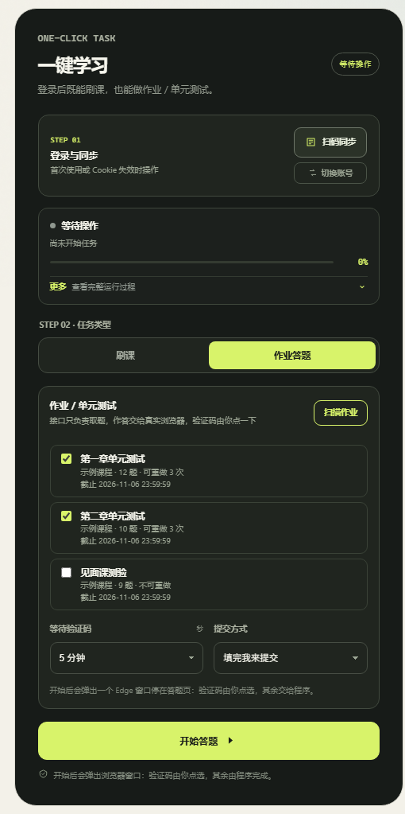
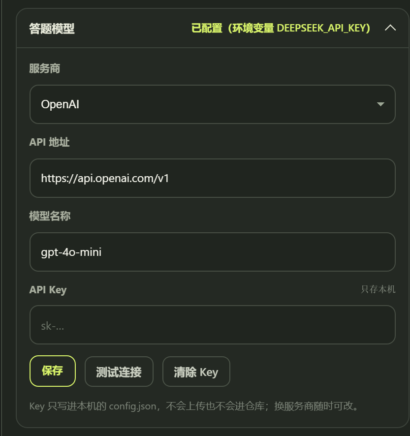

# ZHS 学习助手

**一个带 Windows 桌面界面的智慧树 / 知到课程工具：批量处理课程学习，用大模型生成作业答案，并在浏览器中辅助填写。**

基于 [VermiIIi0n/fuckZHS](https://github.com/VermiIIi0n/fuckZHS) 维护，保留原项目的课程处理能力，增加桌面控制台、作业答题面板、模型设置和运行状态显示。

[下载 Windows 版](https://github.com/Yongs-PRTS/fuckZHS/releases) · [使用指南](#快速开始) · [自动答题说明](#自动答题怎么用) · [开发与构建](#开发与构建) · [MIT 许可证](LICENSE)

## 这个项目能做什么

| 功能 | 可以完成的事情 | 入口 |
| --- | --- | --- |
| 课程学习 | 扫码登录、同步课程、选择一门或多门课程，依次处理学习任务；支持知到共享课和校内课程 | 桌面「刷课」 / `main.py` |
| 视频弹题 | 处理视频学习过程中出现的小题；与作业、AI 课程考试分别处理 | 随课程任务运行 |
| 普通作业答题 | 扫描章节作业、单元测试、见面课测验，调用你配置的大模型生成答案，在 Edge 中逐题点选 | 桌面「作业答题」 / `homework_browser.py` |
| AI 课程 | 处理知识图谱课程资源和相应测试，使用平台自带 AI 或外部模型；缓存平台公开的正确答案 | `main.py -ai COURSE_ID CLASS_ID` |
| 模型设置 | 填写 API 地址、模型名和 Key，测试连接；支持 OpenAI 兼容的 Chat Completions 接口 | 桌面「作业答题 → 答题模型」 |
| 运行管理 | 查看课程进度和日志、停止任务、设置学习范围和时限、切换登录账号 | 桌面控制台 |

**两个常用场景：**

- **只处理课程学习：**扫码同步 → 勾选课程 → 点击「开始学习」。不需要为普通视频学习配置大模型。
- **辅助填写作业：**配置模型 → 扫描并选择作业 → 人工完成验证码 → 程序填写 → 检查后提交。



## 自动答题支持到什么程度

项目中有三种不同的答题流程，配置和提交方式并不相同：

| 流程 | 支持范围 | 提交方式 |
| --- | --- | --- |
| 视频弹题 | 视频内弹出的课程问题 | 由课程流程处理 |
| 普通作业浏览器模式 | 单选、多选、判断 | 默认「填完我来提交」；可自行切换自动提交 |
| 普通作业接口模式 | 选择、判断、文本填空 | `homework.py --run` 在完整保存后自动提交；`--dry-run` 仅生成答案 |
| AI 知识图谱课程 | 单选、多选、判断 | 所有题目保存成功后自动提交；默认每个知识点最多尝试 3 次 |

自动答题包含以下检查：

- 模型报错时停止，不生成随机答案补齐。
- 答案必须对应当前题目的选项；拒绝未知标签、重复答案和单选题返回多个选项。
- 题量不符、缺题、答案不完整或保存失败时，不自动提交整份试卷。
- 重做后重新核对试卷，避免拿上一轮的选项 ID 填新试卷。
- 浏览器已有选择与生成答案不一致时，保留页面供你核对。
- 只有看到页面提交成功提示，浏览器模式才报告「已提交」；否则保留窗口让你确认。

**这些检查用于减少程序性误填，不保证模型答案正确。** 图片题、复杂公式、填空等浏览器模式不支持的题型需要人工完成。验证码始终由你手动处理。

## 快速开始

### Windows 用户：直接运行 exe

1. 在 [Releases](https://github.com/Yongs-PRTS/fuckZHS/releases) 下载 `ZHS-Desktop.exe`，放进单独的、可写的文件夹。
2. 双击启动，点击「扫码登录并同步」，使用智慧树 / 知到手机端完成扫码。
3. 选择「刷课」或「作业答题」，按对应步骤开始任务。

不需要安装 Python。桌面窗口依赖 Edge WebView2；普通作业的浏览器模式还需要安装 Microsoft Edge。答题时会另外打开 Edge 窗口。

程序首次启动会生成 `config.json`；配置、登录态、课程清单、日志和运行数据保存在 exe 所在目录。升级时替换 exe，保留自己的配置文件即可。

### 开发者：从源码运行

推荐 Windows + Python 3.12，源码语法最低要求 Python 3.10。桌面版和 Edge 作业流程按 Windows 环境维护；其他系统的命令行能力需要自行验证。

```powershell
git clone https://github.com/Yongs-PRTS/fuckZHS.git
cd fuckZHS
python -m venv .venv
.\.venv\Scripts\python.exe -m pip install -r requirements.txt
.\.venv\Scripts\python.exe zhs_app.py
```

仅使用网页控制台调试：

```powershell
.\.venv\Scripts\python.exe web_console.py --open
```

不需要手动创建配置文件。需要参考完整配置结构时，查看 [config.example.json](config.example.json)。

## 自动答题怎么用

### 普通作业：推荐使用桌面浏览器模式

1. 先扫码登录并同步课程。
2. 将任务类型切换到「作业答题」。
3. 展开「答题模型」，填写 API 地址、模型名称和 Key，点击「保存」和「测试连接」。
4. 点击「扫描作业」，勾选要处理的作业。
5. 选择验证码等待时间和提交方式。第一次使用建议保持默认的「填完我来提交」。
6. 点击「开始答题」，在弹出的 Edge 窗口中手动完成验证码。
7. 程序填写后，检查答案并提交；手动模式会保留浏览器窗口。



界面提供 DeepSeek、OpenAI、Moonshot、硅基流动、智谱、通义、本地 Ollama 和自定义地址选项。它们是配置入口，具体模型是否可用取决于服务商、账号权限和接口兼容性。无认证的本地接口也需要填写一个非空占位 Key，以通过本项目的配置检查。

API 地址可填写域名、带版本号的地址或完整 `/chat/completions` 路径。模型名必须使用服务端实际提供的名称；「测试连接」会向所选服务真实发送一次短请求，可能产生调用费用。

命令行也可以使用同一套配置：

```powershell
# 查看可处理的作业
python homework_browser.py --list

# 按作业名筛选，填写后人工检查并提交
python homework_browser.py --run --only "第一章"

# 明确要求程序自动提交
python homework_browser.py --run --only "第一章" --submit
```

`homework.py` 是直接调用平台接口的另一条流程。触发平台验证码时，这条流程可能无法继续，优先使用浏览器模式：

```powershell
# 生成参考答案，不保存答案、不提交试卷；取题仍会访问平台
python homework.py --run --only "第一章" --dry-run

# 接口作答并自动提交，最多额外重做 1 轮，受剩余次数限制
python homework.py --run --only "第一章" --rounds 1

# 核对已提交作业
python homework.py --check --only "第一章"
```

### AI 知识图谱课程：命令行模式

这不是桌面里的普通「作业答题」。需要提供 AI 课程 ID 和班级 ID：

```powershell
python main.py -ai COURSE_ID CLASS_ID

# 只处理课程资源，跳过考试
python main.py -ai COURSE_ID CLASS_ID --noexam
```

在 `config.json` 中设置 `ai`：

- `enabled: true`：启用 AI 答题。
- `use_zhidao_ai: true`：使用平台自带 AI，不要求外部模型 Key；是否可用取决于平台会话和课程权限。
- `use_zhidao_ai: false`：使用外部模型。填写 `ai.openai`，或者将其中的 Key 留空，复用桌面「答题模型」或环境变量。
- `max_exam_attempts: 3`：每个知识点最多尝试次数，范围 1–10；全部正确立即结束，达到上限仍未通过会报告失败。
- `ppt_processing.provide_to_ai`：可选的 PPT 转文本参考材料功能，默认关闭；开启后需要单独配置 Moonshot 接口。

答案缓存位于 `aiexamAnswer/`，参考材料缓存位于 `AiDownloadCache/`。请不要把这些账号运行数据上传到仓库。

### 用环境变量配置模型

普通作业模型参数的优先级是：**显式参数 > 本机配置 > 环境变量**。如果本机已保存 Key，想改用环境变量，需要先清除已保存的 Key。

| 环境变量 | 用途 |
| --- | --- |
| `DEEPSEEK_API_KEY` | 使用 DeepSeek 默认接口与默认模型 |
| `OPENAI_API_KEY` | 使用 OpenAI 默认接口与默认模型 |
| `HOMEWORK_LLM_KEY` | 自定义接口 Key |
| `HOMEWORK_LLM_BASE` | 自定义接口地址 |
| `HOMEWORK_LLM_MODEL` | 自定义模型名 |

Key 保存在本机配置或环境变量中，调用时会发送给你配置的模型服务。题干、选项和启用的参考材料也会随请求发送给该服务。选择服务地址前请确认它可信。

## 常见情况与限制

| 遇到的情况 | 如何处理 |
| --- | --- |
| 登录过期、课程列表为空 | 重新扫码；切换账号后重新同步和扫描作业 |
| 没有配置模型、401 / 403 | 检查所选服务的 Key、接口地址和账号权限 |
| 模型连接成功但答题失败 | 检查模型是否按要求返回答案格式；连接成功不等于答题正确 |
| 出现验证码 | 在弹出的 Edge 中手动处理；等待超时后重新开始 |
| 页面选项不匹配、已选答案不同 | 在保留的浏览器中核对，不要把「未完成」当作提交成功 |
| 图片题、复杂题型、非标准页面 | 手动作答；当前文本模型不会可靠读取题目图片 |
| 没看到提交成功提示 | 进入平台核对实际状态，避免盲目重复提交或重做 |

平台接口和页面可能变化，无法保证所有学校、课程和题型都可用。不要将程序当作无人值守、保证满分的服务。请在有权使用的账号和课程范围内操作，并遵守学校与平台的要求。

本版通过了离线回归、本地 Edge 夹具与打包启动检查，**尚未完成真实账号的端到端作业提交验证**。发布不代表所有课程已完成实测。

## 本地文件与隐私

| 文件或目录 | 内容 |
| --- | --- |
| `config.json` | 本机设置、模型 Key 等 |
| `cookies.json` | 登录态 |
| `execution.json` | 课程清单 |
| `logs/`、`runtime/` | 日志、后台状态、二维码和浏览器运行数据 |
| `aiexamAnswer/`、`AiDownloadCache/` | 答案和参考材料缓存 |

这些文件已被 `.gitignore` 排除。反馈问题时请先删去日志和截图中的账号、学号、Key、Cookie、二维码及其他个人信息。

## 开发与构建

主要模块：

| 文件 | 作用 |
| --- | --- |
| `zhs_app.py`、`desktop_app.py` | Windows 桌面入口和窗口管理 |
| `web_console.py`、`web/` | 本机控制台接口和前端 |
| `app_worker.py` | 后台任务与进度反馈 |
| `homework.py` | 作业接口、模型答案生成与校验 |
| `homework_browser.py` | Edge 答题流程与页面核对 |
| `fucker.py` | 课程处理、视频弹题与 AI 课程核心逻辑 |
| `tools/` | 离线回归、打包检查和源码打包工具 |

离线检查需要 Node.js 运行前端回归，不使用真实账号或付费模型：

```powershell
python -m unittest discover -s tools -p "test_*.py" -v
python tools/audit_checks.py

# 可选：真实 Edge、本地 HTML 夹具，不访问课程网站
python tools/test_homework_browser.py --smoke --headless
```

构建 Windows 单文件程序与干净源码包：

```powershell
powershell -ExecutionPolicy Bypass -File .\build_windows.ps1 -OutputDir .\releases
python tools/smoke_packaged.py --exe .\releases\ZHS-Desktop.exe
python tools/prepare_release.py
```

源码打包使用文件白名单；`releases/ZHS-source.zip` 不包含本机配置、Cookie、日志、浏览器数据和 exe。exe 单独作为 GitHub Release 附件发布。

## 项目来源与维护记录

- 原项目：[VermiIIi0n/fuckZHS](https://github.com/VermiIIi0n/fuckZHS)，原作者版权及 MIT 许可保留在 [LICENSE](LICENSE)。
- [2026-10-31 自动答题修复与验证记录](docs/RELEASE_2026-10-31.md)
- [2026-11-01 发布说明](docs/RELEASE_2026-11-01.md)
- [历史 README 与技术研究记录](docs/LEGACY_README.md)：归档内容可能与当前版本不同，现行用法以本文为准。
