> 历史文档归档：保留原作者说明、早期用法和技术研究记录。当前功能、使用方法和限制请以仓库根目录 README 为准。

# ZHS Fucker 食用指北

> 2026-10-31 维护版：自动答题已增加严格答案检查、完整试卷检查和有限重试。
> 普通作业支持桌面界面，AI 知识图谱课程使用命令行。当前验证以离线回归为主，
> 尚未在本轮用真实账号提交作业；平台接口或页面变化仍可能影响运行。
> [本轮修复与发布说明](../docs/RELEASE_2026-10-31.md)。原作者与 MIT 许可见 [LICENSE](../LICENSE)。

## 从源码开始

推荐 Windows + Python 3.12（语法最低 3.10），作业浏览器模式需要 Microsoft Edge。

```powershell
python -m venv .venv
.\.venv\Scripts\python.exe -m pip install -r requirements.txt
.\.venv\Scripts\python.exe zhs_app.py
```

首次运行会生成本机 `config.json`。也可从 `config.example.json` 复制；示例不含登录信息和密钥。
普通作业默认填完后由你检查并提交，验证码需要手动完成；文本模型不自动回答含图片的题目。

开发检查（需要 Node.js 以运行前端回归）：

```powershell
.\.venv\Scripts\python.exe -m unittest discover -s tools -p "test_*.py" -v
.\.venv\Scripts\python.exe tools/audit_checks.py
.\.venv\Scripts\python.exe tools/prepare_release.py
```

最后一条生成 `releases/ZHS-source.zip` 和校验清单，只收录发布白名单中的文件。
上传 GitHub 时使用解压后的源码，包含隐藏的 `.github` 与 `.gitignore`；不要上传整个工作目录。
exe 应作为 Release 附件发布，不能把含 Cookie、日志和浏览器数据的 `dist` 文件夹整体发布。

## NEWS

我总觉得有一天这个脚本会被 `404` ，没想到以这种形式实现了，感谢各位对鸽鸽的支持。


---

在 TG 上出现了倒卖开源代码的家伙, 其谎称有我的授权. [详见此处](https://github.com/VermiIIi0n/fuckZHS/discussions/19#discussioncomment-4168410).

本脚本是为人节约生命的, 不是增加负担的, 况且屎山代码我也不好意思卖, 倒卖就算了别说是我授权的, 丢不起这个脸

愿意支持的朋友点个 ☆ 就好, 叔叔我承诺本~~屎山~~脚本可能会下架, 但永不会变质.

---

## WTF?

这是一个 _Python3_ 的自动脚本, 用于自动刷智慧树课堂课程, 为您节约有限的生命.

### Features

- 支持校内学分课与知到共享学分课
- 自动回答弹题
- 普通作业答题（桌面版可视化操作）与 AI 课程答题（命令行）
- 设定时限
- 射后不管, 无需交互

---

## WHY?

自从智慧树的校内学分课(i.e. hike)播放页面用了个窒息的 _JavaScript_ 混淆之后, 大部分前端的脚本都没法用了.  
因为它会检查 _DevTools_ 是否打开, 如果打开了就无法继续运行, 要分析的话由于混淆, 解读很麻烦.  
于是我打算直接抄家, 入它后端(\*), 之后便有了该脚本. (虽然最后还是被逼着反混淆了前端代码...)

---

## 实用链接

- [版本更新注意事项](https://github.com/VermiIIi0n/fuckZHS/discussions/24)
- [常见问题](https://github.com/VermiIIi0n/fuckZHS/discussions/25)
- [讨论区](https://github.com/VermiIIi0n/fuckZHS/discussions)

---

## 准备工作

您还需要做以下准备:

- _Python3.10_ 及以上版本(或自行改写旧版不兼容的语法)
- 执行 `pip install -r requirements.txt` 安装依赖

---

## 如何使用

因登陆验证改变**目前仅有二维码登陆可用**

本块分为

0. Ultra Quick Start: 执行 `python main.py`

   - 仅以交互输入信息, 除非开 DEBUG 模式否则不留任何敏感记录

### Windows 桌面版

窗口使用系统标题栏（最小化 / 最大化 / 关闭完好），但左侧的图标和标题文字被隐藏，
标题栏做成 Win11 的雾面（Mica）效果。

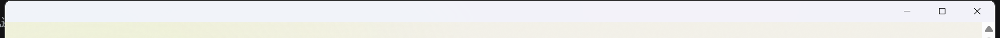

项目可以打包为一个原生 Windows 桌面程序 `ZHS-Desktop.exe`, 不需要安装 Python、打开命令行或启动浏览器:

1. 双击 `ZHS-Desktop.exe`。
2. 程序会在自己的桌面窗口中打开学习控制台。
3. 点击“扫码登录并同步”, 使用手机扫码。
4. 同步完成后选择课程, 点击“开始学习”。

配置、Cookie、课程清单和日志会保存在 exe 同目录, 升级时请保留这些文件。首次运行时会自动创建 `config.json`。程序内部只监听本机随机端口, 不会打开浏览器或上传密码。

在项目目录执行以下命令可重新生成 exe:

```powershell
powershell -ExecutionPolicy Bypass -File .\build_windows.ps1
```

输出文件为 `dist\ZHS-Desktop.exe`。如果 Windows SmartScreen 提示未知发布者, 这是因为本地构建的程序没有代码签名, 可点击“更多信息”后确认运行。

开发时也可以直接启动源码桌面版:

```bash
python zhs_app.py
```

如果只想使用浏览器调试, 可以执行 `python web_console.py --open`。

#### AI 课程自动答题 (命令行)

AI 课程 (知识图谱课) 的作答目前只在命令行提供:

```bash
python main.py -ai <COURSE_ID> <CLASS_ID>
```

答题引擎由 `config.json` 的 `ai` 段决定: `use_zhidao_ai: true` 用智慧树自带 AI, 否则用
`ai.openai` 里配置的 OpenAI 兼容接口。答案会缓存到 `aiexamAnswer/<课程ID>/`。

1. `Login`: 输入账号与密码

   - 使用配置文件
   - 使用命令行参数

2. `Fxxking`: 开干

   - 使用命令行参数
   - 拉清单
   - 参数列表

3. `API` 简易文档: 用于单独使用模块

### Login

_\*如果非常用地登入（可能？）会需要短信验证, 您应该先用浏览器登入一次, 以让您的所在地列入白名单。_  
 _\*\*信息优先级: 命令行 > 配置文件 > 交互输入_

### 使用配置文件

配置文件 _config.json_ 中有以下字段:

```JSON
{
  "username": "",
  "password": "",
  "qrlogin": true,
  "save_cookies": true,
  "proxies": {},
  "logLevel": "INFO",
  "tree_view": true,
  "progressbar_view": false,
  "qr_extra": {
      "show_in_terminal": null,
      "ensure_unicode": false
  },
  "image_path": "",
  "pushplus": {
      "enable": false,
      "token": ""
  },
  "bark": {
      "enable": false,
      "token": "https://example.com/xxxxxxxxx"
  },
  "config_version": "1.3.0"
}
```

- `username`: 账号
- `password`: 密码
- `qrlogin`: **目前强制启用**二维码登陆, 方便在服务器上部署, 优先级高于账号密码
- `proxies`: 代理, 可留空, 在 _Windows_ 上还可解决 _Clash_ 等代理造成的证书错误, 详见 [_常见问题_](https://github.com/VermiIIi0n/fuckZHS/discussions/25)
- `logLevel`: 日志等级, 可选 `NOTSET` `DEBUG` `INFO` `WARNING` `ERROR` `CRITICAL`
- `save_cookies`: 保存cookies，*短时间*内可以自动登录。
- `tree_view`: 课程目录结构，关闭后不显示所有课程目录。
- `progressbar_view`: 进度条控制，关闭后不显示当前视频进度。
- `image_path`: 登录二维码保存路径，留空则不保存。
- `qr_extra`: QR 相关配置
  - `show_in_terminal`: 将二维码打印至终端
  - `ensure_unicode`: 仅使用 Unicode 字符打印二维码
- `pushplus`: 基于 [pushplus](https://www.pushplus.plus) 的推送服务
  - `enable`: 启用推送
  - `token`: 推送 token
- `bark`: 基于 [bark](https://github.com/Finb/Bark) 的推送服务
  - `enable`: 启用推送
  - `token`: 推送 token，例如：`https://api.day.app/xxxxxxxxxxxxx`

~~填入账号密码即可无干预自动登入~~ **当前失效**  
 _\*配置文件如果没有的话会在 main.py 执行时自动创建._

### 使用命令行参数登入

```bash
python main.py -u <username> -p <password>
python main.py -q
```

- `-u` `--username`: 账号
- `-p` `--password`: 密码, 要注意密码将会明文留在记录中, 故不推荐使用 `-p` _\*虽然说这破站密码泄漏就泄露吧, 写配置文件里多方便, 俗话说晚泄不如早泄(¿)_
- `-q` `--qrlogin` : 启用二维码登陆

---

### Fxxking

### 命令行指北

**以下假设您已经在配置文件中输入必要信息**  
 _\*信息优先级: 命令行 > 配置文件 > 交互输入_

```bash
cd fuckZHS
python main.py # 如果 execution.json 不存在的话, 刷所有课
# 只刷课程 ID 为 114514 和 1919180 的课
python main.py -c 114514 1919180
# 想秒过可以设个很高的 SPEEEED
python main.py -s 444 # 我就感觉到快, 有种催人ban的感觉
# 又或者可以限制每节课学习25分钟
python main.py -c 114514 -l 25
# 遇到问题想开 debug 模式, 顺带加个代理?
python main.py -c 114514 -d --proxy http://127.0.0.1:2333
# 又比如您想只干某几个视频, 那您可以使用 -v 传入视频 ID
python main.py -c 114514 -v 1989 604
# 刷ai课程，ai课程号为 114514，classId为 4444
python main.py -ai 114514 4444
```

什么？不知道课程 ID 或视频 ID? 进入课程界面就可以在网址里看到了.  
 _\*课程 ID 为网址中的 `courseId`(校内学分课) 或 `recruitAndCourseId`(共享学分课) 参数_  
 _\*\*更多选项请使用 `-h` 查看._

### 拉清单

使用 `--fetch` 参数可从服务器获得所有课程清单, 存储到 _execution.json_ 这个小本本里, 您可以删去不想干的课程  
当该文件存在且没有指定课程 ID 时, 会先看看这个小本本上有没有写着课程 ID  
_\*清单中 `id` 参数是必须的, 想额外拉清单时请注意_  
_\*\*修改时请注意 JSON 语法, 不然 Exceptions 会一下突开到脸上_

```bash
python main.py --fetch
```

清单示例:

```JSON
[
    {
        "name": "中国近现代史",
        "id": "42"
    },
    {
        "name": "思想道德与法治",
        "id": "1919"
    }
]
```

### 命令行参数列表

- `-c`, `--course`: 课程 ID, `courseId` 或 `recruitAndCourseId`, 可输入多个
- `-v`, `--videos`: 视频 ID, `fileId` 或 `videoId`, 可输入多个
- `-u`, `--username`: 账号
- `-p`, `--password`: 密码
- `-q`, `--qrlogin`: 二维码登录，目前**强制开启**
- `-s`, `--speed`: ~~**POWERR AND SPEEEEED!**~~ 指定播放速度, 想要秒过可以设个很高的值(e.g. 644), 但不推荐. 默认为浏览器观看能到的最大值
- `-t`, `--threshold`: 完成时播放百分比, 高于该值视作完成, 想要重复刷课可以使用大于 `1.0` 的值, 例如 `2.0` 则会再刷一遍
- `-l`, `--limit`: 单节课的时限, 如果您看得上内点习惯分就用吧
- `-d`, `--debug`: 调试级日志记录, 会记录请求到日志 **_(可能包含账号密码, 别乱分享, 当心被盒武_**
- `-f`, `--fetch`: 获取课程清单并存入 _execution.json_ 文件
- `--show_in_terminal`: 将二维码打印至终端
- `--proxy`: 代理设置, 本来用来调试的(e.g. <http://127.0.0.1:8080>)
- `--tree_view`: 课程目录结构，关闭后不显示所有课程目录。
- `--progressbar_view`: 进度条控制，关闭后不显示当前视频进度。
- `--image_path`: 登录二维码保存路径，留空则不保存。
- `-ai`, `--aicourse`: AI课程, Input AI Course ID and CLASS ID to fu*k aiCourse
- `-h` `--help`: 显示帮助

运行示例如下:
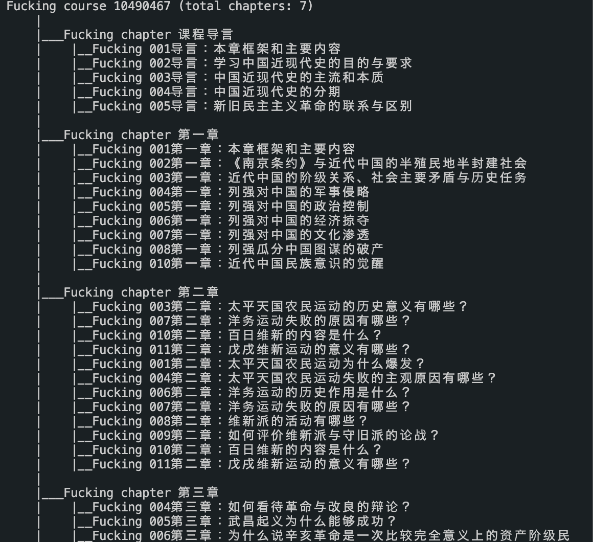

指北就这些啦, ~~代码很少可以自己看~~ 现在不少了().

---

### `API` 简介

详见源码

#### 实例化 `Fucker`

```Python
from fucker import Fucker

fucker = Fucker()
# 或者更进阶一些
fucker = Fucker(speed=1.5, end_thre=0.91)
# 以上控制播放速度以及终止临界值
# speed: 校内学分课播放速度正常最高为1.25, 共享学分课为1.5, 但似乎更高的服务器也接受, 不过怕暴露就谨慎些吧
# end_thre: 智慧树把高于一定百分比的进度视为完成, 0.91 保险一点
# 以上俩参数仅对视频有效, 其他的内容就只有进度0或1
```

### `login` Method

如果您能自己得到 `Cookies` 就可以略过, 直接给 `Fucker` 实例的 `cookies` 属性赋值即可
_Python3_ 登入样例

```Python
fucker.login(username:str, password:str)
fucker.login(username:str, password:str, interactive=False) # 禁用交互, 在账号或密码为空时引发异常

# 如果您不想使用 login
# 也可直接传入符合 requests 库要求的 cookies
fucker.cookies = {key: "Angel Beats!", "inside Uncle's eyes": value}
# 该 cookies 会覆盖原有值, 同时请确保它是完整的智慧树 cookies，因为 uuid 需要从 cookies 中解析
```

### `fuckCourse` Methods Family

```Python
fucker.fuckCourse(course_id:str) # 把整个课程都干了
fucker.fuckCourse(course_id:str, tree_view=False) # 把整个课程都干了, 但不显示树状视图
fucker.fuckZhidaoCourse(recruitAndCourseId) # 点名就要干知到共享学分课
fucker.fuckHikeCourse(courseId) # 点名就要干校内学分课(hike)
```

### `fuckVideo` Methods Family

```Python
fucker.fuckVideo(course_id, video_id) # 指定干某节课里某视频
fucker.fuckZhidaoVideo(recruitAndCourseId, videoId) # 这里的 videoId 是从 网页API响应 中获得的
fucker.fuckHikeVideo(courseId, fileId) # 这俩就在 校内学分课(hike) 网址里
```

### `getContext` Methods Family

```Python
fucker.getZhidaoContext(recruitAndCourseId)
fucker.getHikeContext(courseId)
fucker.getHikeContext(courseId, force=True) # 强制更新context并重置课程学习时间(本地记录)
'''
自动在 `fuck*Course` `fuck*Video` 中被调用
返回一个 `dict`, 内含该 ID 对应课程的必要信息以及实例运行后学习该课的总时间, 必要信息没有的话会向服务器请求
该 `dict` 结构请见源码
'''
```

### `hike` API

```Python
# 自动添加时间戳和签名, 并检查返回代码
def hikeQuery(self, url:str, data:dict,sig:bool=False, ok_code:int=200, setTimeStamp:bool=True, method:str="GET")...
# 以下为与网页接口同名的 API, 只返回响应中的 "rt" 部分
def queryResourceMenuTree(self, course_id)...
def stuViewFile(self, course_id, file_id)...
def saveStuStudyRecord(self, course_id, file_id, played_time, prev_time, start_date)...
```

### `zhidao` API

```Python
# 自动添加时间戳和加密, 并检查返回代码
def zhidaoQuery(self, url:str, data:dict, encrypt:bool=True, ok_code:int=0, setTimeStamp:bool=True, method:str="POST", key=VIDEO_KEY)...
# 以下为与网页接口同名的 API, 只返回响应中的 "data" 部分
def gologin(self, RAC_id)...
def queryCourse(self, RAC_id)...
def videoList(self, RAC_id)...
def queryStudyReadBefore(self, course_id, recruit_id)...
def queryStudyInfo(self, lesson_ids:list, video_ids:list, recruit_id)...
def queryUserRecruitIdLastVideoId(self, recruit_id)...
def prelearningNote(self, RAC_id, video_id)...
def loadVideoPointerInfo(self, RAC_id, video_id)...
def lessonPopoupExam(self, RAC_id, video_id, question_ids:list)...
def saveLessonPopupExamSaveAnswer(self, RAC_id, video_id, question_id, answer_ids:str)...
def saveDatabaseIntervalTime(self, RAC_id, video_id, played_time, last_submit, watch_point, token_id=None)...
def saveCacheIntervalTime(self, RAC_id, video_id, played_time, last_submit, watch_point, token_id=None)
```

---

## 作业（单元测试）自动答题

刷课、弹题、AI 课程考试之外, 智慧树还有一类完全不同的东西: **作业 / 单元测试 / 见面课测验**,
它走 `studentexam-api`, 与本项目的刷课接口无关, 由独立的 [homework.py](../homework.py) 处理。

```bash
# 只读: 列出所有课程的未完成作业(不动任何数据)
python homework.py --list

# 做作业: 默认不重做, --rounds 允许未满分时重做
python homework.py --run --rounds 2

# 只做某一门课 / 某一份作业
python homework.py --run --course "孔子与《论语》" --only "第一章"
python homework.py --run --only "绪论单元测试" --dry-run   # 只看题和答案, 不保存不提交

# 提交后核对每道题的对错
python homework.py --check --only "第一章单元测试"
```

### 答题模型（自己填 API）

仓库里**不包含任何 API Key**，下载后由你自己填。桌面版在「作业答题 → 答题模型」里配置，
保存后会写进本机的 `config.json`（已在 `.gitignore` 中，不会被提交）。

| 项目 | 说明 |
|---|---|
| 服务商 | DeepSeek / OpenAI / Moonshot / 硅基流动 / 智谱 / 通义 / 本地 Ollama / 自定义 |
| API 地址 | 留默认即可；只填域名会补成 `/v1/chat/completions`，带 `/v1`、`/v4` 等版本号则原样拼接 |
| 模型名称 | 例如 `deepseek-chat`、`gpt-4o-mini`、`qwen-plus` |
| API Key | 只存本机，界面里只显示 `sk-abc…wxyz` 掩码 |

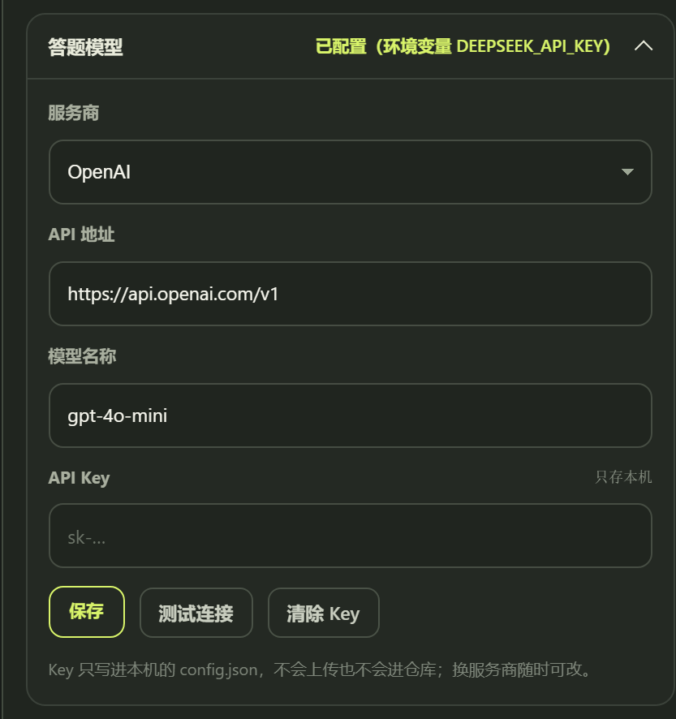

点「测试连接」会真的发一次最短请求，能返回内容才算通过。没配置 Key 时点「开始答题」会直接
提示去配置，不会拿空答案提交。

命令行同样可用，优先级为 **显式参数 > 本机配置 > 环境变量**：

| 环境变量 | 默认 base_url | 默认模型 |
|---|---|---|
| `HOMEWORK_LLM_KEY` / `HOMEWORK_LLM_BASE` / `HOMEWORK_LLM_MODEL` | 自定义 | 自定义 |
| `DEEPSEEK_API_KEY` | `https://api.deepseek.com` | `deepseek-chat` |
| `OPENAI_API_KEY` | `https://api.openai.com` | `gpt-4o-mini` |

AI 课程 (`main.py -ai`) 的 `config.ai.openai` 没填时，也会自动复用这里配置的模型。
需要先设置 `ai.use_zhidao_ai: false` 才使用外部模型；为 true 时使用平台自带 AI。
每个知识点最多尝试 `ai.max_exam_attempts` 次（默认 3，范围 1–10），全对立即结束；
模型失败、答案不合法、漏题或保存失败会停止，不随机选择，也不提交不完整试卷。

找不到 Key 时直接报错退出, **不会用随机答案糊弄**。

### 工作流程

```
CAS SSO → getStudentHomework(列表) → doHomework(取题)
        → saveStudentAnswer(逐题保存) → submit(提交)
        → lookHomework + getStuAnswerInfo(逐题核对)
        → 未满分且还有重做次数 → saveCourseTran(重置) → 重做, 只重新回答错题
```

重做时, 已确认错误的选项组合会被写进提示词, 要求模型换一个组合, 避免同一题反复错在同一个答案上。
注意作业的选项顺序每次打开都会被服务端打乱, 程序是按当次返回的顺序做映射的。

### 注意

- 「见面课测验」和部分从没重做次数的作业是**一锤子买卖**, 建议先用 `--dry-run` 看一遍答案质量再提交。
- 作业答案由大模型生成, 正确率不是 100%, 请自行判断是否使用。
#### 图形界面里的「作业答题」

桌面控制台的 **STEP 02 · 任务类型** 有两个模式：**刷课** 与 **作业答题**。

1. 切到「作业答题」，点 **扫描作业**（走接口拉清单，不触发验证码）；
2. 勾选要做的作业（列表里会标出题数、可重做次数、截止时间）；
3. 选 **等待验证码** 时长与 **提交方式**；
4. 点 **开始答题** —— 会弹出一个 Edge 窗口停在答题页，你在验证码里点几下，程序自动作答。

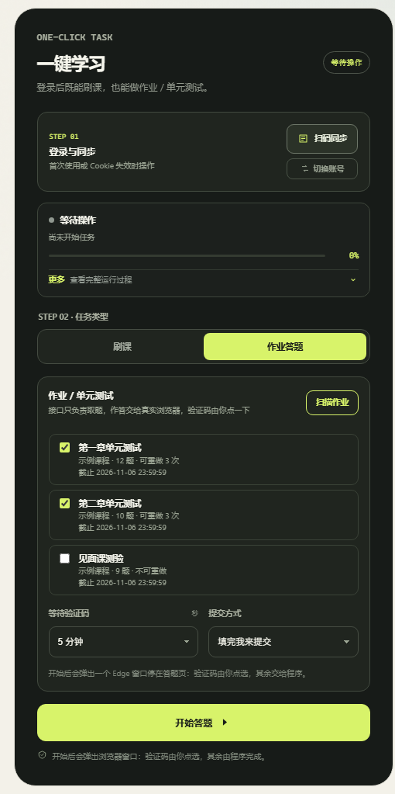

默认是「填完我来提交」，程序不会自动点提交按钮；选了「自动提交」才会代你提交。

手动模式会保留 Edge 窗口，并显示「等待检查并提交」；请检查、提交后自行关闭。
自动提交只有检测到页面成功提示才显示已提交，否则保留窗口供你确认。
浏览器自动作答支持单选、多选和判断；遇到填空或未支持题型会明确停止，请在网页手动完成。

### 切换账号

STEP 01 的「登录与同步」下方新增 **切换账号**：

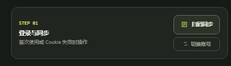

- 点击后会先确认（提示当前课程清单会被覆盖）；
- 确认后**忽略已保存的登录态**，强制重新生成登录二维码；
- 扫码成功后覆盖 `cookies.json`、重新拉取课程清单、清空旧账号的作业缓存。

命令行等价写法：`python main.py -q`（删除 `cookies.json` 后再运行）。

### 刷课时的进度与验证码提示

- 正在看的视频会实时回传「已播秒数 / 总秒数」，状态卡显示**整体百分比**（多门课时按课程均分）。
- 每条进度同时写进日志，「完整运行过程」里能看到逐条时间线。
- 一旦接口返回验证码要求（`code: -12`），任务会**停在这门课**并把位置写进状态：

  `需要验证码：孔子与《论语》 / 第三章 礼与仁 / 3.2 克己复礼`

  状态卡会变成橙色告警，提示你到网页对应位置完成验证码后重新开始。

### 半自动模式（命令行版）

接口路线在触发风控后会被拒（只回一句 `滑块验证未通过`，没有图也没有票据），
但网页端会弹**易盾点选验证码**，人工点一下即可通过。`homework_browser.py` 就是这条路：

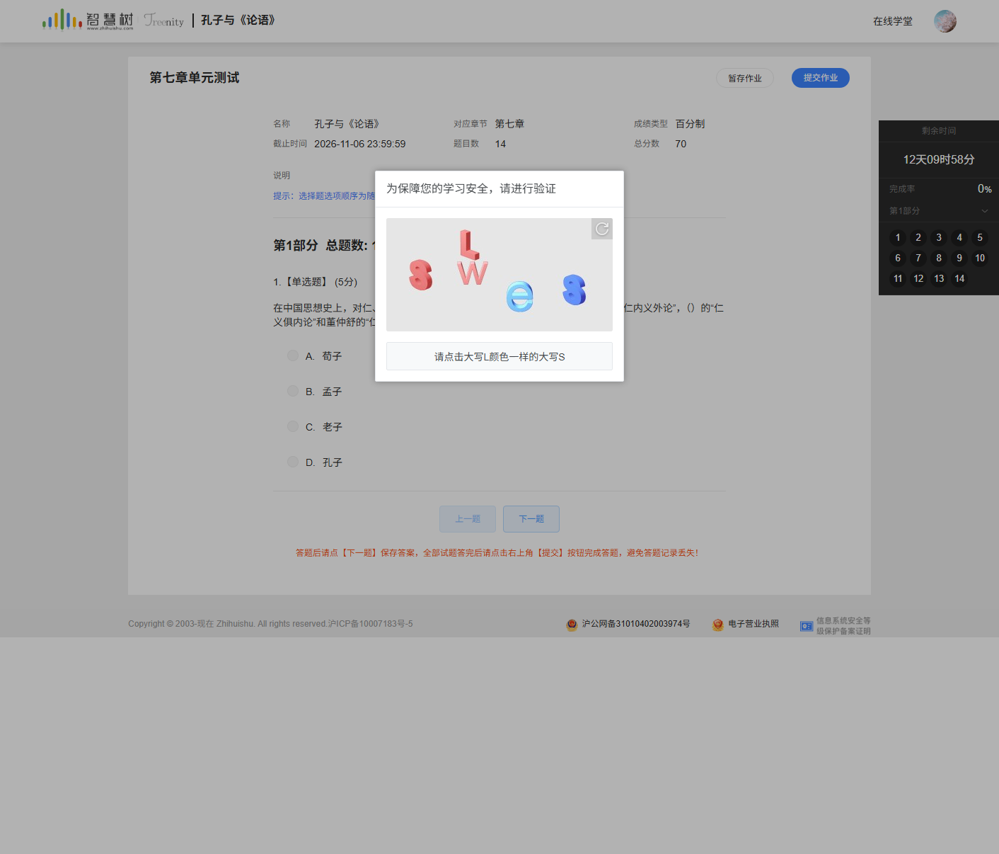

```bash
# 1. 先用接口看有哪些作业（不受验证码影响）
python homework_browser.py --list

# 2. 半自动答题：打开可见的 Edge，你点掉验证码，程序自动作答
python homework_browser.py --run --only "第七章"

# 3. 想让它填完直接提交
python homework_browser.py --run --only "第七章" --submit
```

浏览器连接按本次启动的临时配置目录识别，每次使用独立调试端口，保留的检查窗口不会被下一次任务复用。
Edge 启动进程退出后，以实际调试连接判断窗口是否仍可用；连接失败时会清理本次启动资源。
如需单独检查启动，可运行 `python tools/test_homework_browser.py --smoke`：
它只打开两个空白 Edge 窗口，验证连接、窗口隔离和关闭，不读取账号或提交作业。

流程：

```
接口取题 + LLM 生成答案（不碰风控）
  → 打开学生中心 → 点该课的「作业考试」→ 点该作业的「开始答题」
  → 弹易盾点选：你在窗口里点 3 下
  → 程序按选项 id 逐题点选、点「下一题」保存
  → 默认不提交，你检查后自己点；加 --submit 才自动提交
```

注意：

- 默认**不自动提交**，避免又出现"空卷 0 分"。
- 手动提交模式会保留窗口，不再限时 10 秒关闭；题量不符、答案无效或保存不完整时拒绝自动提交。
- 选项 id 与接口返回的答案一一对应（页面选项顺序会打乱，但 id 不变），
  每答一题都会校验"当前可见选项集合"和接口是否一致，对不上就停手，不会乱点。
- 需要 `websocket-client`（已加入 requirements.txt）。

- 连续高频请求会触发智慧树的**滑块验证**(`滑块验证未通过，不能答题`)。这是账号级风控,
  换会话、换 UA、补 Referer 都绕不过去(实测), 响应里也没有可编程的挑战票据, 只能靠
  人工过一次滑块或等它冷却。程序识别到后会立即停手且**不会提交空卷**;
  可用 `--wait-captcha 10 --captcha-retries 3` 让它自己等冷却后重试, 并把 `--only`
  缩小到单份作业降低频率。

---

## 踩坑记录

构建过程中真实踩过、并且修掉的坑（验证码风控、网页改版、CDP 超时、窗口卡死、打包坑等），
整理成了 [docs/PITFALLS.md](../docs/PITFALLS.md)。每条都写了 **现象 → 原因 → 处理 → 验证**，
如果遇到奇怪的失败，可以先翻这份文档。

2026-10-27 的复查及修复见 [审查报告](../docs/BUG_AUDIT_2026-10-27.md) 和
[修复记录](../docs/FIXES_2026-10-27.md)。可运行 `python tools/audit_checks.py` 做离线回归检查（另需 Node）。

---

## 结构介绍

### 文件结构

- main.py: 命令行主函数
- sign.py: 负责生成 hike API 所需的 `signature` 参数
- utils.py: 一些常用工具
- logger.py: 日志工具, 将不同等级的日志写入不同文件
- fucker.py: `Fucker` 类定义, 所有核心代码全塞一起了, 莫在意
- ObjDict.py: `ObjDict` 类定义, 继承自 `dict`, 可以 `object` 属性形式访问 `dict`
- zd_utils.py: 知到 API 所需的工具, 如生成 `ev` 和 `secretStr`
- app_config.py: 运行期路径与默认配置、原子写 JSON
- app_worker.py: 后台任务(runtime/request.json → runtime/action.json)
- web_console.py: 本地 HTTP 服务与任务管理
- desktop_app.py / zhs_app.py: 桌面窗口与统一入口
- homework.py: 作业 / 单元测试自动答题(接口版)
- homework_browser.py: 作业答题的浏览器半自动版(验证码人工过)
- web/: 控制台前端(index.html / app.js / styles.css)
- docs/: 踩坑记录(`PITFALLS.md`)
- config.json: 首次运行时自动生成, **不要提交**
- meta.json: 包含版本和分支等信息, 也用于更新检查
- decrypt: 非必要的文件夹, 内含逆向源代码的工具及源码打包

### Fucker Class Structure

```Python
class Fucker:
    def __init__(self, cookies: dict = None,
                 headers: dict = None,
                 proxies: dict = None,
                 limit: int = 0,
                 speed: float = None,
                 end_thre: float = None)...

    @property # cannot directly manipulate _cookies property, we need to parse uuid from cookies
    def cookies(self)...
    @cookies.setter
    def cookies(self, cookies: dict|requests.cookies.RequestsCookieJar)...

    def login(self, username: str=None, password: str=None, interactive: bool=True)...
    def fuckCourse(self, course_id:str, tree_view:bool=True)...
    def fuckVideo(self, course_id, video_id:str)...
############################################
# for some fucking reasons
# there are 2 sets of completely different API for hike.zhihuishu.com and studyservice-api.zhihuishu.com
# so we need to use different methods for different API
#############################################
# following are methods for studyservice-api.zhihuishu.com API
    def getZhidaoContext(self, RAC_id:str, force:bool=False)...
    def fuckZhidaoCourse(self, RAC_id:str, tree_view:bool=True)...
    def fuckZhidaoVideo(self, RAC_id, video_id)...
    def answerZhidao(self, q:dict)...
    def _zhidaoQuery(self, url:str, data:dict, encrypt:bool=True, ok_code:int=0,
               setTimeStamp:bool=True, method:str="POST")...
# end of zhidao methods
#############################################
# following are methods for hike API
    def getHikeContext(self, course_id:str, force:bool=False)...
    def fuckHikeCourse(self, course_id:str, tree_view:bool=True)...
    def fuckHikeVideo(self, course_id, file_id, prev_time=0)...
    def fuckFile(self, course_id, file_id)...
    def _traverse(self,course_id, node: ObjDict, depth=0, tree_view=True)...
    def _hikeQuery(self, url:str, data:dict,sig:bool=False, ok_code:int=200,
                   setTimeStamp:bool=True, method:str="GET")...
# end of hike methods
#######################################
# shared private methods
    def _watchVideo(self, video_id)... # it's probably unnecessary but let's keep it to fool those idiots
    def _apiQuery(self, url:str, data:dict, method:str="POST")...
    def _checkCookies(self)...
    def _checkTimeLimit(self, cid)...
    def _sessionReady(self, ctx:dict=None)...
```

我的很大, 你忍一下(指类定义)

---

## 后记

这一段算是授之以渔吧, 毕竟网站以后更新可能会改内容, 我又没时间更新, 就先把思路写在这. 但要注意, 下文提到的混淆肯定引入了随机量, 不可完全照搬该思路.  
过程中用到的文件样本大多都在 _decrypt_ 目录下压缩档里.

**_以下内容仅针对校内学分课的 `API` ("hike" 开头的域名)_**

### Chapter 0: Too Young Too Naive

本以为从后端入手会很轻松, 目前绝大部分的脚本是在前端实现刷智慧树自动化(有例外但那些都不是对付校内学分课的), 这样做不仅鲁棒性很差而且过于复杂, 本脚本则直接绕后, 甩开前端, 可以做到不变应万变...吧?

#### 捉包

总之先捉个包看看前端怎么和服务器交流, 没想到一开浏览器开发者模式就遇到了问题.  
一旦监测到 _DevTools_, 网页界面就立即停止响应.  
但这还不简单, 手动把相关 _JavaScript_ 无脑删不就行, 源码都在我手上有什么好怕的.

紧接着一看源码:

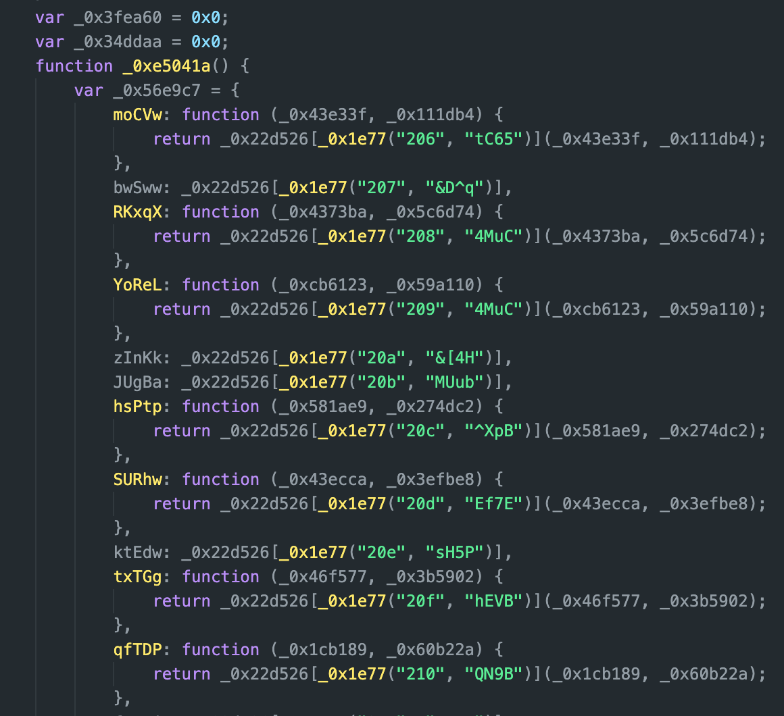
_好家伙《乱码 1/2》_

不过这也没什么, 我本来就只是想抓个包, 用别的工具就是了.

抓包得到页面向服务器报告进度的甜言蜜语:  
`Headers`:
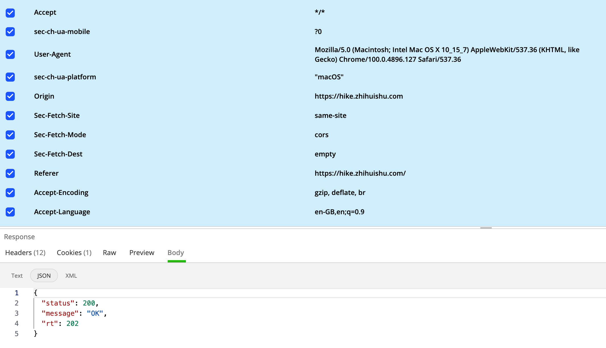

`Params`:
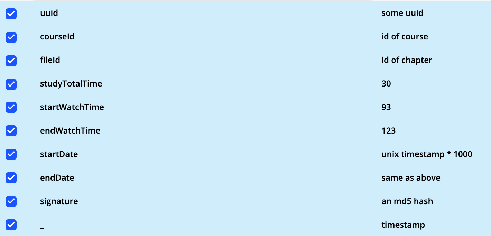
_\*敏感信息被替换了_  
您看看这些人多不专业, 拿 `GET` 干 `POST` 的活, 而且那个 `uuid` 根本就不是真的 UUID, 七八个随机字符而已.

#### 模拟请求

不过我们一路顺风, 成功就在眼前(flag++).  
这时可以看到一个正常的响应是:

```JSON
{
  "status": 200,
  "message": "OK",
  "rt": 202
}
```

`rt` 是服务器返回的观看进度.

包里大部分参数都很直接, 我们照搬便是.  
`courseId` 我们可以从浏览器链接里得知,  
`fileId` 每个章节的都不一样, 可以从“<https://studyresources.zhihuishu.com/studyResources/stuResouce/queryResourceMenuTree>” 中获取的 JSON 中得到, 源码里有, 不再赘述.

剩下只有 `signature` 不明, 不过大概是个防止多次提交的随机字符串罢了, 毕竟这群人取名似乎一直不太准确.

然后一试

```JSON
{
  "status": 200,
  "message": "OK",
  "rt": null
}
```

**???**  
为何就返回个 `null`, 为了解决这个问题我快把浏览器内核用 _Python_ 实现了, 一直以为就是个 `Headers` 或者 `Cookie☆` 的问题, 我可能缺了什么.  
结果最后才发现问题在 `Params`, 而且就是里面那个该死的 `signature` 造成的.  
这次他们取对名字了, 这真是个签名, 必须和其他内容配套才能被视作合法请求, 并得到 `rt`.  
想要自己生成这个 `MD5` 签名就只能从前端代码里找 salt 等数据.

没办法, 开始人生第一次反混淆 _JavaScript_ 吧...

---

### Chapter 1: At Beginning, It's Just Chaos

下图开头这个站点名就是万恶之源了, 话说为什么叫“加密”, 只是混淆而已, 和加密相差太远了, 只能说连名字都取的很 Obfuscated.

首先得把这些诡异变量重命名一下, 在 [_这个站点_](https://deobfuscate.io) 可以初步反混淆, 去掉一些简单的函数 wrapping 并重命名变量, 新变量名当然是随机的, 只是好读一些.

#### 初步反混淆

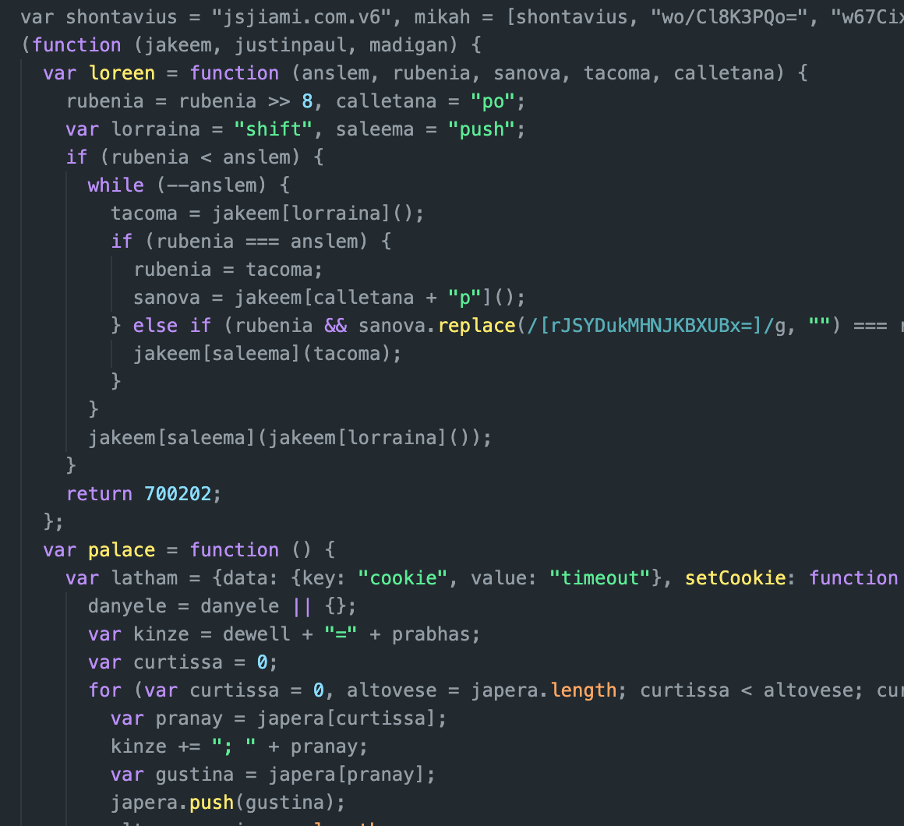
这下好多了, 我们可以看 **_不_** 到开头有一行超大的列表(太长了就只截了前几个), 不过它大概有 1.4k 个**字符串**,  
看起来是 Base64, 解码后是乱码, 是被加密了(真·加密).

再观察一下可以发现一个函数出现的次数很多:
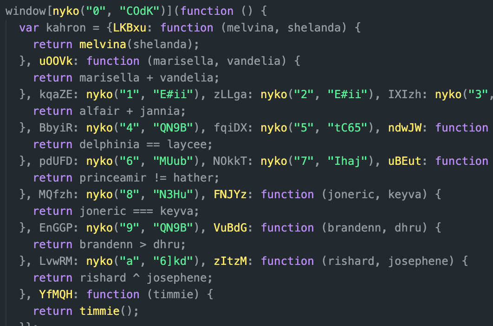
这个 nyko 便是负责解密的函数.

要反混淆 nyko 就需要手动去掉一堆无用的循环和分支, 不然真读不下去.  
恶心的是这个混淆后版本里充斥着各种看起来有意义的字符串, 甚至有些就是混淆前代码里的, 但他们被拿来进行无意义的比较和循环, 这样做可以同时迷惑您和您的 CPU.

总之反混淆出来是这样一个简单的解密程式, 用 _Python_ 重新实现了:

```Python
def decrypt(index:str, key:str):
    index = int(index, 16)
    encrypted = b64dec(table[index])
    key = key.encode()

    mod_sum = 0
    ar = list(range(256))
    for i in range(256):
        mod_sum = (mod_sum + ar[i] + key[i % len(key)]) % 256
        ar[i], ar[mod_sum] = ar[mod_sum], ar[i]
    mod_sum = 0
    n = 0
    decrypted = ""
    encrypted = encrypted.decode()
    for i in range(len(encrypted)):
        n = (n + 1) % 256
        mod_sum = (mod_sum + ar[n]) % 256
        ar[mod_sum], ar[n] = ar[n], ar[mod_sum]
        decrypted += chr(ord(encrypted[i]) ^ ar[(ar[mod_sum] + ar[n]) % 256])
    return decrypted
```

_JavaScript_ 原版其实在 Base64 解码后, 还有个手动把内容 URLEncode 了, 又调用 `decodeURIComponent` 解码的诡异操作.  
一开始我把它删了, 结果竟然生成内容不一样. 似乎是 _JavaScript_ 的 `atob` 似乎会保留非法的内容? 经过看似无意义的 URL Encode&Decode 会把这些字符丢弃掉, 只能说混淆者真是钻研了折磨人的极致了, 好在 _Python_ 的 `b64decode` 默认丢弃这些内容. _\*此部分存疑, 不确定原因是不是这个_

接下来尝试对列表内容解密, 发现还是乱码...

没办法, 只得继续化简开头的函数, 看看会有什么线索.  
接着发现程式开头有一段循环, 把列表开头和结尾的俩无意义的东西扔了, 顺带把这个列表旋转了 138 位, 用 _Python_ 表示就是 `deque.rotate(-138)`  
这个值是好像是固定的, 但保不准以后会变

#### 解读解密后代码

解密并替换内容后的文件:
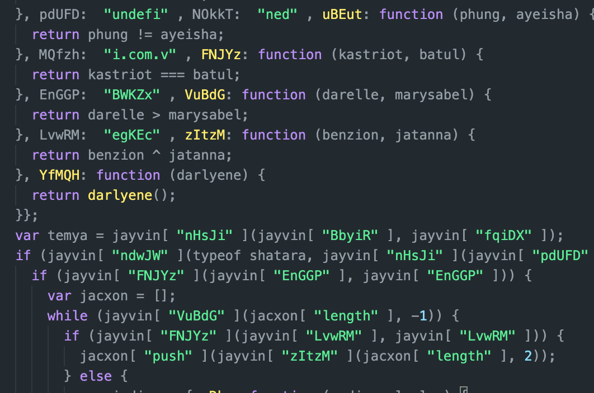

解密之后常量已经可以看到了, 但其中仍有很多垃圾信息.  
比如其中有类模式, 就是混淆版本会在一个 `Object` 内包装一堆简单的函数, 比如加减和比较, 然后取个无意义的名字.  
结合那一堆无意义的变量来做比较判断, 以此来表示单个 `Boolean` 值.  
因为嵌套的次数太多所以自动反混淆没能解决它们, 但只要搞清这点可以手动去掉很多无意义的分支.

```JavaScript
var Wtf = {
       RvuT: function (dyo, bie){
       return dyo === bie;
       },
       oPhT: function(Jely, Inp, Stb){
       return Jely(Inp, Stb)
       },
       stEbU: "d0gky", RlVDj: "rk8Eb"
    }
if (Wtf.oPhT(Wtf.RvuT,Wtf.stEbU,Wtf.RlVDj){
    console.log("WTF");
    }

//以上这一大坨， 也就等价于
if (false){
  console.log("who cares what I've logged");
  }

//也就等价于
//do fucking nothing but consuming your CPU, storage, network bandwidth and god damn time

```

---

### Chapter 2: Let There = Light

总算看见曙光了, 但要继续解读的话, 这些乱码的函数名字太难读了, 以功能来重新命名吧, 顺便去掉无用的, 重复的部分:

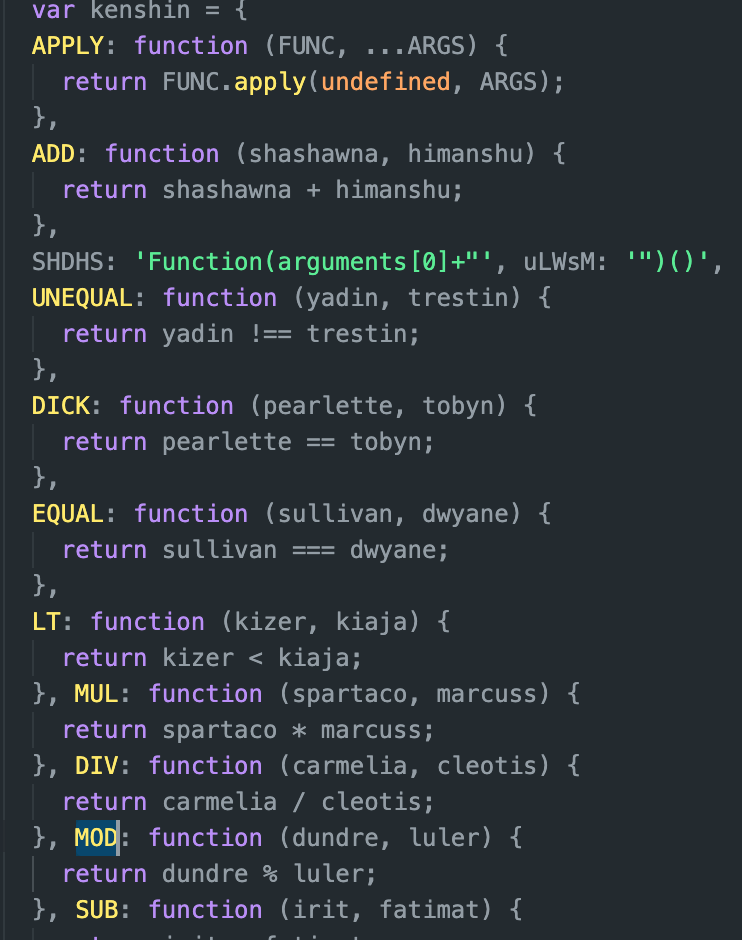

怎么说呢, 虽然是很繁琐的一件事, 但看着大批大批代码被删有种莫名的快感, 我当游戏玩了一久.

玩得差不多的时候突然想起来我好像不必把所有代码反混淆, 找到 `MD5` 相关的代码就好啊.  
现在代码也只有一千多行了, 挺好找的才是.  
随手一翻发现:

```JavaScript
function jobany(params) {
      var lennora = kenshin.ADD(kenshin.ADD(
        kenshin.ADD(kenshin.ADD(kenshin.ADD(
          kenshin.ADD(kenshin.ADD(kenshin.ADD(
            kenshin.ADD("o6xpt3b#Qy$Z", params.uuid
          ), params.courseId),  params.fileId
        ), params.studyTotalTime),  params.startDate
      ), params.endDate),  params.endWatchTime
    ), params.startWatchTime),  params.uuid);
      console.log(lennora);
      return kenshin.APPLY($md5, lennora);
    }
```

~~_"Here↘ comes ↗Jobany~"_~~  
诶嘿, 改函数名有效果了, 是**盐**! 它加了**盐**! (顺带特想吐槽下这个自动生成的对象名 `kenshin`，挺中二)

**盐**(bushi):


---

### Chapter 3: small step, Giant Leap

为了个区区 `signature` 废了好大功夫  
不过有了这个我们可以自己签名了, 没想到人都这么大了还靠在自己作业上签名来骗人

```Python
from hashlib import md5
from ObjDict import ObjDict # 这是一个我从 dict 继承后魔改的玩意儿，可以用 JavaScript 风格访问 dict

SALT = "o6xpt3b#Qy$Z"

def sign(p:dict):
    p = ObjDict(p)
    raw = SALT + p.uuid + p.courseId + p.fileId + p.studyTotalTime + \
           p.startDate + p.endDate + p.endWatchTime + p.startWatchTime + p.uuid
    return md5(raw.encode()).hexdigest()
```

我们也算是**努力**的**靠自己**完成作业了

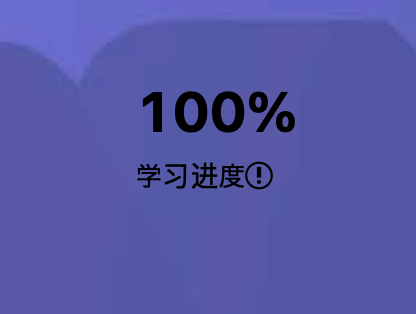  
~~_已经 1000%了()_~~

---

给把如此凌乱的内容看到最后您一些安慰吧  
祝您学习像 Anya 一样好, 料理如 Yor 一般出色!

(sauce: Pixiv; pid:[97128620](https://www.pixiv.net/en/artworks/97128620)) **_放 GitHub 仓库不能算转载吧?_**
